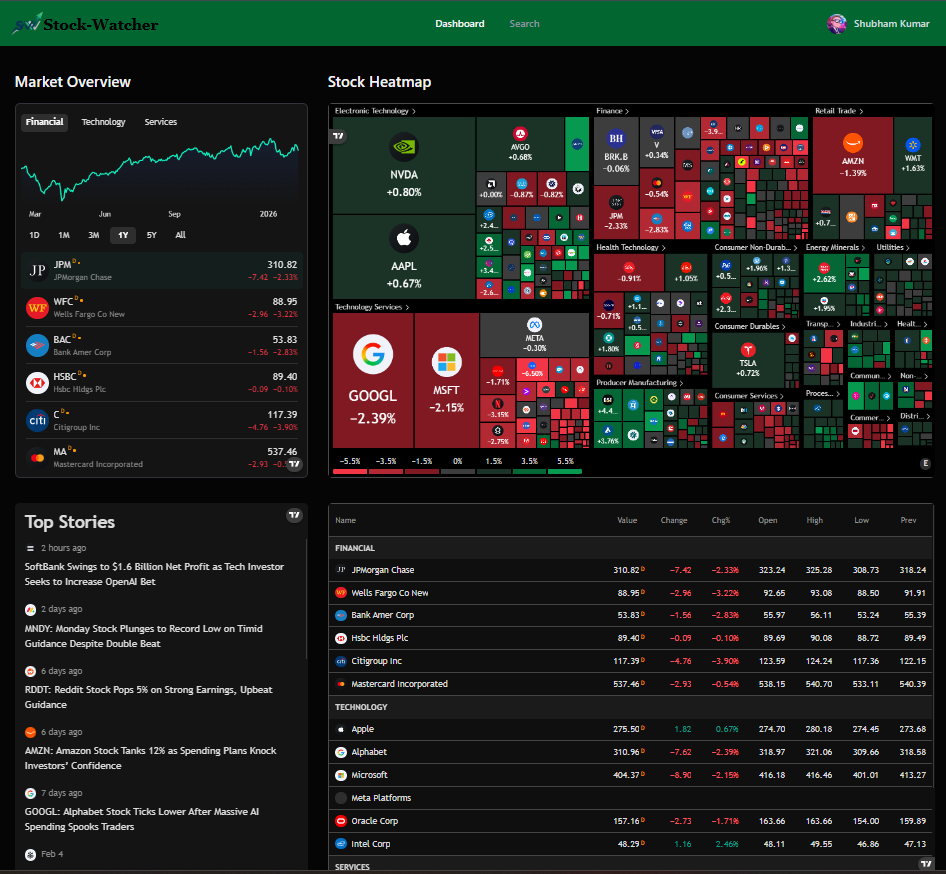

# 📈 Intelligent Stock Market Platform — Alerts, Analytics & AI Insights

---

## 📚 Table of Contents

- 🌟 Overview
- 🛠 Technology Stack
- 🚀 Core Features
- 🏁 Getting Started

---

## 🌟 Overview

This project is a modern, AI-driven stock market web application designed to deliver real-time financial data, intelligent insights, and automated alerts within a sleek and responsive interface.

Users can:
- Monitor live stock prices
- Analyze interactive charts
- Build personalized watchlists
- Receive automated notifications
- Explore deep company-level analytics

An integrated **Admin Dashboard** enables platform management, including stock control, news publishing, and monitoring user engagement.

Behind the scenes, event-based workflows automate notifications, AI-generated summaries, earnings alerts, and sentiment tracking — making this project a complete real-time financial ecosystem.

Whether you're enhancing your portfolio or learning advanced Next.js architecture, this project demonstrates scalable and production-level design patterns.

---

## 🛠 Technology Stack

### 🎨 Frontend Development
- **Next.js** – High-performance React framework with server capabilities
- **TypeScript** – Strongly typed JavaScript for maintainable code
- **Tailwind CSS** – Utility-first styling system
- **Shadcn UI** – Accessible and customizable component library

### 🔐 Authentication & Security
- **Better Auth** – Flexible authentication system with support for credentials and social login

### 📊 Financial Data Integration
- **Finnhub API** – Real-time stock market, forex, and crypto data provider
- **Gemini API** – AI-powered content summaries and financial insights

### 🗄 Data Storage
- **MongoDB** – Scalable NoSQL document-based database

### ⚡ Background Processing
- **Inngest** – Event-driven workflows and task automation engine

### 📧 Communication
- **Nodemailer** – Email service integration for alerts and notifications

### 🤖 Code Quality Enhancement
- **CodeRabbit** – AI-assisted pull request code review system

---

## 🚀 Core Features

### 📈 Interactive Market Dashboard
- Live stock price tracking
- Dynamic line and candlestick charts
- Historical trend visualization
- Filtering by sector, market cap, and performance

### 🔎 Smart Search Engine
- Rapid and intelligent stock discovery
- Optimized navigation experience

### ⭐ Watchlist Management & Custom Alerts
- Personalized stock tracking
- Custom price and volume thresholds
- Real-time email notifications

### 🏢 In-Depth Company Analytics
- Key financial metrics (PE ratio, EPS, revenue)
- Analyst ratings and recommendations
- Market sentiment analysis
- Latest company news and filings

### ⚡ Automated Event Workflows
Powered by Inngest:
- Real-time price monitoring
- Scheduled alert triggers
- Automated reporting systems
- Earnings update notifications

### 🤖 AI-Driven Summaries & Notifications
- Personalized daily market digests
- Automated earnings breakdowns
- Context-aware stock insights

### 🔔 Flexible Notification Preferences
- User-configurable alert settings
- Watchlist-based customization

### 📊 Administrative Control Panel
- Manage stock listings
- Publish financial updates
- Track user engagement metrics

---

## 🏁 Getting Started

Follow the steps below to run the application locally.

### ✅ Requirements

Ensure the following tools are installed:

- Git  
- Node.js  
- npm  

---

## Learn More

To learn more about Next.js, take a look at the following resources:

- [Next.js Documentation](https://nextjs.org/docs) - learn about Next.js features and API.
- [Learn Next.js](https://nextjs.org/learn) - an interactive Next.js tutorial.

You can check out [the Next.js GitHub repository](https://github.com/vercel/next.js) - your feedback and contributions are welcome!

## Deploy on Vercel

The easiest way to deploy your Next.js app is to use the [Vercel Platform](https://vercel.com/new?utm_medium=default-template&filter=next.js&utm_source=create-next-app&utm_campaign=create-next-app-readme) from the creators of Next.js.

Check out our [Next.js deployment documentation](https://nextjs.org/docs/app/building-your-application/deploying) for more details.
